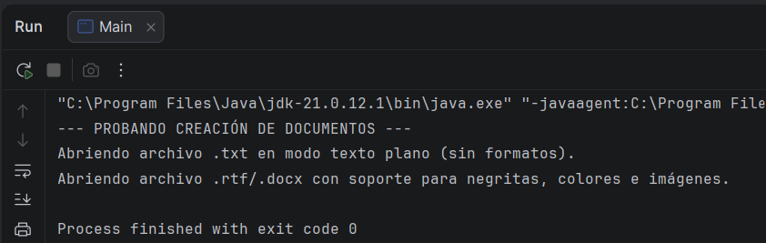

- Diseño de Software - Módulo 3
- Ejercitación - Patrón Factory Method
Ejercicio 1: Generador Básico de Documentos de Texto
Contexto del problema:
Una aplicación de ofimática necesita crear diferentes tipos de documentos editables (como archivos de texto plano y documentos enriquecidos) sin acoplar el código principal a las clases concretas de cada formato.

Objetivo de aprendizaje:
Comprender la estructura básica y el propósito fundamental del patrón Factory Method delegando la instanciación de objetos en subclases especializadas.

Requisitos funcionales:

Definir una interfaz común para los documentos que permita invocar una operación de apertura o renderizado básico.

Permitir la creación de documentos de texto plano y documentos enriquecidos mediante clases creadoras concretas.

Restricciones técnicas:

El código cliente no debe utilizar operadores de instanciación directa para crear los documentos, sino que debe invocar un método de fábrica abstracto o virtual.

Las clases creadoras concretas deben retornar el tipo de documento correspondiente a su especialidad.
***
# Lógica y Funcionamiento del Programa:
    Para resolver este problema implementé el patrón Factory Method, separando la lógica de creación de los documentos del código principal de la aplicación.

- Interfaz Documento: Define el contrato común con el método abrir(), asegurando que cualquier formato se pueda manipular de la misma forma.

- Clases DocumentoTextoPlano y DocumentoEnriquecido: Son las implementaciones concretas que definen cómo se comporta cada tipo de archivo al abrirse.

- Clase CreadorDocumento: Es la clase abstracta base que declara el método de fábrica crearDocumento(). Además, incluye un método auxiliar para crear y abrir el archivo directamente sin saber de qué tipo concreto es.

- Clases CreadorTextoPlano y CreadorEnriquecido: Son las subclases creadoras concretas. Cada una sobrescribe el método de fábrica para instanciar y devolver únicamente el tipo de documento que le corresponde.

- Clase Main: En la prueba instancié los creadores especializados en lugar de hacer new directamente sobre los documentos. De esta forma, el código cliente queda totalmente desacoplado de las clases concretas de los archivos y trabaja únicamente contra las abstracciones.
***
# Ejecucion por consola
